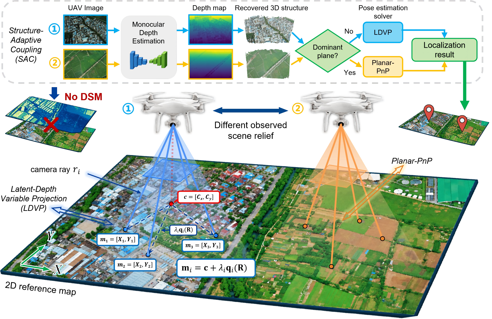

# DSM-Free UAV Visual Localization via Latent-Depth Variable Projection and Structure-Adaptive Coupling （[Paper](https://arxiv.org/abs/2610.14945)）

If you find our work useful, please consider giving us a ⭐️. Your support means a lot to us! 🥰🥰🥰

**Background:** Accurate UAV visual localization against geo-tagged orthographic maps commonly relies on a **Digital Surface Model (DSM)** to lift 2D map correspondences into 3D for PnP. However, high-resolution DSMs are costly to acquire and maintain, may have limited spatial resolution, and can quickly become outdated as urban and natural environments change. This dependence restricts the practical deployment of orthographic-map-based localization, particularly in large-scale or rapidly changing areas where reliable scene elevation is unavailable. **Enabling accurate metric localization without DSM data is therefore critical for making widely available orthographic maps usable as standalone references.**

**Method:** We address this challenge with a **DSM-free UAV localization framework** built on **Latent-Depth Variable Projection (LDVP)** and **Structure-Adaptive Coupling (SAC)**. LDVP reformulates orthographic–perspective geometry by assigning each perspective viewing ray an unknown latent depth; these nuisance variables are eliminated analytically, while the horizontal camera center is solved in closed form conditioned on rotation. The resulting reduced optimization directly estimates the metric horizontal pose, bypassing both scene elevations and intermediate matrix decomposition. We further reveal that DSM-free pose observability is intrinsically governed by scene structure: elevation variation strengthens the geometric constraints, whereas the planar limit induces rotation–translation coupling. This insight motivates SAC, which uses relative structure inferred from monocular depth—rather than metric depth—to identify the geometric regime and adaptively couple LDVP with Planar-PnP, exploiting their complementary strengths across relief-rich and approximately planar scenes.

<p align="center">
  
</p>
<p align="center"><em>Overview of the proposed DSM-free UAV localization framework. LDVP directly estimates metric horizontal pose without DSM elevations, while SAC uses monocular relative structure to adapt between LDVP and Planar-PnP according to the matched scene geometry.</em></p>

## Highlights

- **DSM-free metric localization:** LDVP enables accurate UAV-to-map localization without requiring DSM data.
- **Structure-adaptive pose estimation:** SAC uses monocular relative structure to adapt between LDVP and Planar-PnP.
- **Evaluation across benchmarks and matchers:** experiments are supported on **AnyVisLoc** and **OrthoLoC** with multiple matching backends.

This repository releases the **LDVP** and **LDVP+SAC** methods from our paper, together with implementations of **DSM-PnP** and **Planar-PnP** for comparison.

## Installation

Clone this repository and enter the project directory:

```bash
git clone https://github.com/UAV-AVL/LDVP-SAC.git
cd LDVP-SAC
```

Create the localization environment:

```bash
conda create -n ldvp_sac python=3.10 -y
conda activate ldvp_sac
pip install -r requirements.txt
```

The provided `requirements.txt` records the PyTorch versions used in our tested environment (`torch==2.5.1`, `torchvision==0.20.1`). If your CUDA setup requires a different PyTorch build, follow the official [PyTorch installation guide](https://pytorch.org/get-started/locally/) and make sure the installed PyTorch / torchvision versions are compatible with your system.

Depth generation should be run in a **separate MoGe2-Aerial environment**. Follow the official [MoGe2-Aerial](https://github.com/kuieless/AerialMetric) installation instructions.

<details>
<summary><b>Repository structure</b></summary>

```text
<repository-directory>/
├── run_benchmark.py
├── bootstrap.py
├── requirements.txt
├── configs/
│   └── config_selectable_matchers.yaml
├── datasets/
│   ├── anyvisloc.py
│   ├── anyvisloc_common.py
│   ├── ortholoc.py
│   └── ortholoc_common.py
├── methods/
│   ├── pnp.py
│   ├── ldvp.py
│   └── sac.py
├── depth/
│   ├── depth_estimation_anyvisloc_moge2_aerial_h5.py
│   └── depth_estimation_ortholoc_moge2_aerial_h5.py
└── external/
    └── AnyVisLoc/
        ├── avl_data.py
        └── avl_utils.py
```

</details>

## Dataset Preparation

### AnyVisLoc

Download the dataset by following the official [AnyVisLoc Benchmark](https://github.com/UAV-AVL/Benchmark) instructions.

A typical dataset root contains scene folders such as:

```text
AnyVisLoc/
├── Scene_01/
├── Scene_02/
├── ...
└── Scene_24/
```

Use this directory as:

```bash
--dataset_root /path/to/AnyVisLoc
```

### OrthoLoC

Download the dataset by following the official [OrthoLoC](https://github.com/deepscenario/OrthoLoC) repository.

The runner supports the official splits:

```text
train/
val/
test_inPlace/
test_outPlace/
```

Use the directory containing these splits as:

```bash
--dataset_root /path/to/OrthoLoC
```

## Matching Models

This release reuses the pixel-matching backends from the [AnyVisLoc Benchmark](https://github.com/UAV-AVL/Benchmark). The third-party matcher source code, pretrained models, and checkpoints are **not redistributed** in this repository.

Prepare the official AnyVisLoc `Matching_Models/` directory and its required checkpoints following the AnyVisLoc setup instructions. It does **not** need to be copied inside this repository. A convenient layout is:

```text
workspace/
├── Benchmark/                     # official AnyVisLoc repository
│   └── Matching_Models/
│       ├── RoMa/
│       └── Sparse_matchers/
└── LDVP-SAC/
```

Then pass:

```bash
--matching_models_root /path/to/Benchmark/Matching_Models
```

For selectable sparse matchers, also pass:

```bash
--selectable_code_dir /path/to/Benchmark/Matching_Models/Sparse_matchers
```

The AnyVisLoc release provides the expected checkpoint layout for RoMa and the sparse matcher variants. Please keep the original filenames and follow the licenses of the corresponding third-party projects.

<details>
<summary><b>Supported matcher names</b></summary>

The matcher name is selected with:

```bash
--matching_method MATCHER_NAME
```

The released runner is intended for the following AnyVisLoc matching backends:

```text
Roma
SP_LG
ALIKED_LG
DISK_LG
```

`Roma` uses the RoMa implementation under `Matching_Models/RoMa/`.

`SP_LG`, `ALIKED_LG`, and `DISK_LG` use the selectable sparse matcher code under `Matching_Models/Sparse_matchers/`. 

</details>

## MoGe2-Aerial Depth Generation

SAC uses monocular depth for relative structural analysis. The release provides two scripts:

```text
depth/
├── depth_estimation_anyvisloc_moge2_aerial_h5.py
└── depth_estimation_ortholoc_moge2_aerial_h5.py
```

Install [MoGe2-Aerial](https://github.com/kuieless/AerialMetric) following its official instructions first. We recommend copying the two depth-generation scripts from this repository into the **MoGe2-Aerial / AerialMetric repository root**, and then running them inside the MoGe2-Aerial environment.

For example:

```bash
cp /path/to/LDVP-SAC/depth/depth_estimation_anyvisloc_moge2_aerial_h5.py /path/to/AerialMetric/
cp /path/to/LDVP-SAC/depth/depth_estimation_ortholoc_moge2_aerial_h5.py /path/to/AerialMetric/

cd /path/to/AerialMetric
conda activate <moge2-aerial-env>
```

### AnyVisLoc depth

From the AerialMetric repository root, run:

```bash
python depth_estimation_anyvisloc_moge2_aerial_h5.py \
  --dataset_root /path/to/AnyVisLoc \
  --save_dir /path/to/anyvisloc_depth_output \
  --anyvisloc_code_root /path/to/LDVP-SAC/external/AnyVisLoc \
  --aerialmetric_root /path/to/AerialMetric \
  --device cuda:0
```

The default HDF5 filename is:

```text
anyvisloc_moge2_aerial_depth.h5
```

### OrthoLoC depth

The OrthoLoC depth script uses the configuration block at the top of the file. Before running, set at least:

```python
ORTHOLOC_ROOT = "/path/to/OrthoLoC"
SAVE_BASE_PATH = "/path/to/ortholoc_depth_output"

AERIALMETRIC_ROOT = "/path/to/AerialMetric"
MOGE_CHECKPOINT = "/path/to/AerialMetric/weights/Moge2-Aerial.pt"
MOGE_LORA_CONFIG = "/path/to/AerialMetric/MoGe/configs/train/v2.json"
```

The MoGe2-Aerial environment must also be able to import the official OrthoLoC package:

```bash
python -c "from ortholoc.dataset import OrthoLoC; print('OrthoLoC import OK')"
```

Then, from the AerialMetric repository root, run:

```bash
python depth_estimation_ortholoc_moge2_aerial_h5.py
```

The output HDF5 filename is:

```text
ortholoc_moge2_aerial_depth.h5
```

Use the generated HDF5 file during localization with:

```bash
--depth_root /path/to/depth_file.h5
```

## AnyVisLoc Evaluation

The following example performs online RoMa matching and evaluates all four released methods:

```bash
python -u run_benchmark.py \
  --dataset anyvisloc \
  --dataset_root /path/to/AnyVisLoc \
  --matching_models_root /path/to/Benchmark/Matching_Models \
  --matching_method Roma \
  --depth_root /path/to/anyvisloc_moge2_aerial_depth.h5 \
  --methods DSM-PnP Planar-PnP LDVP LDVP+SAC \
  --s1_threshold 0.5 \
  --plane_threshold 0.003 \
  --plane_ransac_iterations 2000 \
  --print_every 100 \
  --save_every 100 \
  --run_tag AnyVisLoc_Roma
```

<details>
<summary><b>Example with a selectable sparse matcher</b></summary>

For example, SuperPoint + LightGlue:

```bash
python -u run_benchmark.py \
  --dataset anyvisloc \
  --dataset_root /path/to/AnyVisLoc \
  --matching_models_root /path/to/Benchmark/Matching_Models \
  --selectable_code_dir /path/to/Benchmark/Matching_Models/Sparse_matchers \
  --matching_method SP_LG \
  --depth_root /path/to/anyvisloc_moge2_aerial_depth.h5 \
  --methods DSM-PnP Planar-PnP LDVP LDVP+SAC \
  --s1_threshold 0.5 \
  --plane_threshold 0.003 \
  --plane_ransac_iterations 2000 \
  --print_every 100 \
  --save_every 100 \
  --run_tag AnyVisLoc_SP_LG
```

Change only `--matching_method` to test another prepared backend.

</details>

## OrthoLoC Evaluation

The same runner is used for OrthoLoC. The following example performs online RoMa matching over all official splits:

```bash
python -u run_benchmark.py \
  --dataset ortholoc \
  --dataset_root /path/to/OrthoLoC \
  --matching_models_root /path/to/Benchmark/Matching_Models \
  --matching_method Roma \
  --depth_root /path/to/ortholoc_moge2_aerial_depth.h5 \
  --methods DSM-PnP Planar-PnP LDVP LDVP+SAC \
  --set_name all \
  --s1_threshold 0.5 \
  --plane_threshold 0.003 \
  --plane_ransac_iterations 2000 \
  --print_every 100 \
  --save_every 100 \
  --run_tag OrthoLoC_Roma
```

To evaluate one split, replace `--set_name all` with one of:

```text
train
val
test_inPlace
test_outPlace
```

Selectable sparse matchers use the same `--matching_method` and `--selectable_code_dir` settings as in the AnyVisLoc example.

## Results

By default, results are written under:

```text
Result/LDVP_SAC_release/
└── <run_tag>/
    └── <dataset>-<matching_method>/
        └── run_state.json
```

`run_state.json` contains the per-query results, failures, run arguments, and aggregate metrics. During long runs, `--save_every N` controls how often the state is flushed.

To continue an interrupted run, use the same command, the same `--run_tag`, and add:

```bash
--resume
```

## License

The code in this repository is licensed under the **[PolyForm Noncommercial License 1.0.0](https://polyformproject.org/licenses/noncommercial/1.0.0)**.

It may be used, modified, and redistributed for **non-commercial purposes**, including academic research and education, subject to the license terms. **Commercial use is not permitted** without separate permission from the copyright holders.

Third-party code, models, datasets, and checkpoints remain subject to their respective licenses.

## Citation

If you find this work useful in your research, please cite our paper:

```bibtex
@misc{ye2026dsmfreeuavvisuallocalization,
      title={DSM-Free UAV Visual Localization via Latent-Depth Variable Projection and Structure-Adaptive Coupling}, 
      author={Yibin Ye and Xichao Teng and Shuo Chen and Xiaokai Song and Yuli Sun and Qifeng Yu and Zhang Li},
      year={2026},
      eprint={2610.14945},
      archivePrefix={arXiv},
      primaryClass={cs.CV},
      url={https://arxiv.org/abs/2610.14945}, 
}
```

Please replace the placeholder author and arXiv fields with the final paper information before public release.

## Acknowledgement

We thank the authors of the datasets, models, and open-source projects used in this work. Please cite the corresponding papers and comply with their licenses when using these resources.

**Datasets / benchmarks:** [AnyVisLoc Benchmark](https://github.com/UAV-AVL/Benchmark), [OrthoLoC](https://github.com/deepscenario/OrthoLoC)

**Monocular depth:** [Depth Anything 3](https://github.com/ByteDance-Seed/Depth-Anything-3), [MoGe2](https://github.com/microsoft/MoGe), [MoGe2-Aerial](https://github.com/kuieless/AerialMetric)

**Local features / matching:** [RoMa](https://github.com/Parskatt/RoMa), [SuperPoint](https://github.com/magicleap/SuperPointPretrainedNetwork), [ALIKED](https://github.com/Shiaoming/ALIKED), [DISK](https://github.com/cvlab-epfl/disk), [LightGlue](https://github.com/cvg/LightGlue)
